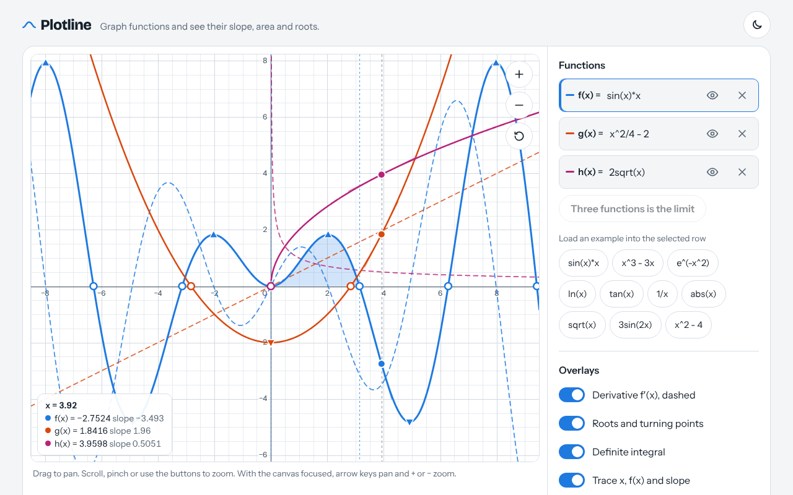

# Plotline

Graph up to three functions and overlay the derivative, a shaded definite integral, roots and turning points.

**Live:** https://lazarzec18.github.io/plotline/



## What it does

- Type functions the way you'd write them: `sin(x)*x`, `x^3 - 3x`, `e^(-x^2)`, `ln(x)`, `|x|`, `sqrt(x)`, with implicit multiplication like `2x` and `3sin(x)`.
- Pan by dragging, zoom with the scroll wheel, a pinch or the + and − buttons, and reset the view in one tap. Asymptotes like `tan(x)` and `1/x` are left as gaps instead of being joined by vertical lines.
- Turn on the derivative f′(x) as a dashed curve, shade a definite integral between a and b (bounds like `pi/2` work) and read its value.
- Mark roots and local maxima and minima on the graph, with a list of their coordinates for everything in view.
- Trace the curve with a crosshair that shows x, f(x) and the slope, plus a tangent line, for every function at once.
- Copy a link that reproduces the exact graph, view and overlays. Your last graph is also remembered between visits.

## How it works

Expressions go through a hand-written tokenizer and a recursive descent parser that builds a tree and compiles it into plain JavaScript closures, so nothing is ever passed to `eval`. The derivative is a central difference, the integral uses composite Simpson's rule with 4000 intervals, and roots come from scanning for sign changes and refining them by bisection. Sign changes are rejected when the function blows up there, which separates real roots from asymptotes. When drawing, a large jump between two neighbouring samples is bisected: if the jump doesn't shrink as the gap closes, it's a discontinuity and the pen lifts.

## Built with

HTML, CSS and JavaScript (Canvas 2D, no frameworks, no build step).

## Run it locally

Open `index.html` in a browser, or serve the folder:

```
python3 -m http.server
```

Then visit http://localhost:8000.

---

Made by [Lazar Zec](https://github.com/LAZARZEC18).
